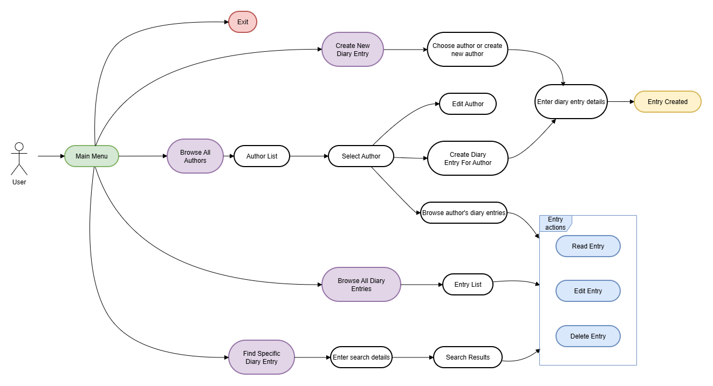

""""

[](https://classroom.github.com/a/NzRaDbQp)

# Portfolio project IDATT1003

This file uses Mark Down syntax. For more information see [here](https://www.markdownguide.org/basic-syntax/).

STUDENT NAME = "André Skjellevik"  
STUDENT ID = "142168"

## Project description

This is a small Java portfolio application implemented as an MVC-style console program for the IDATT1003 assignment.  
The application is a console based diary with CRUD and searching functionalities.



## Project structure

Sources and tests follow a standard Maven layout.

Entire project structure:

```
├───src
│   ├───main
│   │   └───java
│   │       └───edu
│   │           └───ntnu
│   │               └───idi
│   │                   └───idatt
│   │                       ├───controller
│   │                       │   ├───exceptions
│   │                       │   ├───utils
│   │                       │   └───validators
│   │                       ├───model
│   │                       │   │
│   │                       │   └───exceptions
│   │                       ├───view
│   │                       │   ├───actions
│   │                       │   └───menus
│   │                       └Main.java
│   └───test                
│       └───java
│           └───edu
│               └───ntnu
│                   └───idi
│                       └───idatt
│                           ├───controller
│                           │   └───validators
│                           └───model
```

## Link to repository

https://github.com/NTNU-IDI/mappe-2025-askjellevik

## How to run the project

The project is set up with an execution plugin that is set to run the Main.java file.
To start the project this way, simply enter the following command in the terminal

- run: `mvn exec:java`

However, it is necessary to have compiled the correct classes before running.
The recommended command to ensure a clean run:

- Build and run: `mvn clean compile exec:java`

When running the main file the application will start the main method itself.
The program lives in the console and expects user input directly in the console.

## How to run the tests

You can run the tests by running the following command in the terminal
`mvn test`

## References

* [Maven](https://maven.apache.org/guides/index.html)
* [Exec plugin](https://www.mojohaus.org/exec-maven-plugin/usage.html)
* [JUnit 5](https://junit.org/junit5/docs/current/user-guide/)
* [Jansi](https://fusesource.github.io/jansi/)
* Horstmann, C. S. (2020). Core Java, volume I: Fundamentals. Pearson.

